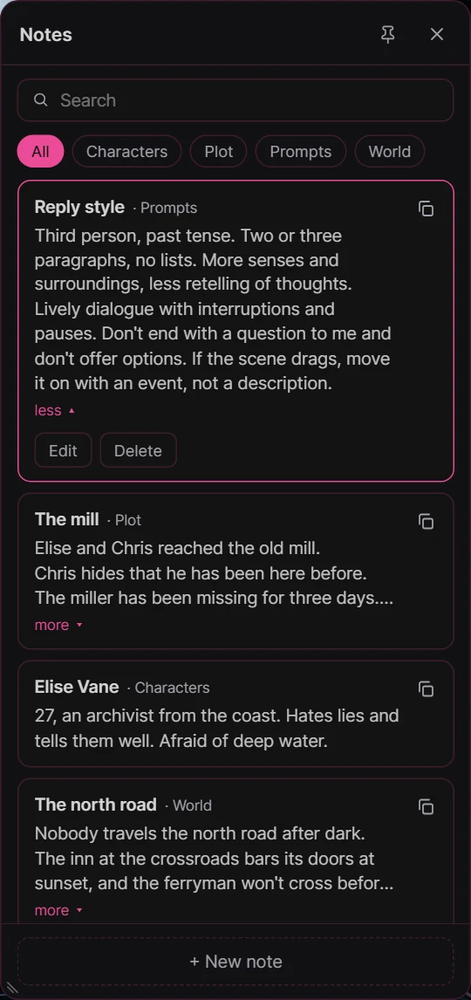
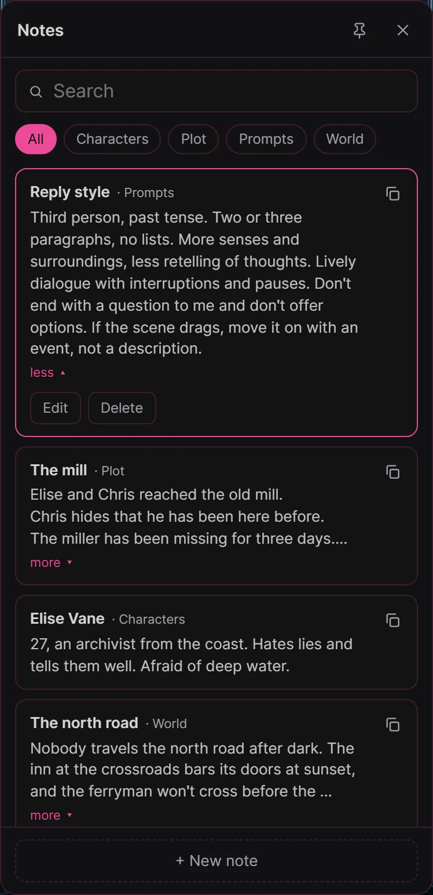

# Notebook

Notes and prompts at hand in [Marinara Engine](https://github.com/Pasta-Devs/Marinara-Engine): a tab at the edge of the
screen opens a panel of cards. Keep your favourite prompts, character sheets, plot threads and world notes there, and
copy any of them into the chat in one click.



> Tested on **Marinara Engine 2.5.2**. The interface is in English. Works with any theme: it uses Marinara's own colours.

## What it does

- **Cards.** Each note has a title, an optional tag and its text. Long notes show three lines; a click opens the whole
  note with **Edit** and **Delete** (delete asks first).
- **Copy.** The sheets icon in a card's corner copies its text.
- **Search and tags.** Search looks through titles, tags and text. Tag chips filter the list.
- **On every device.** Notes are kept on your Marinara server, so your phone, tablet and computer see the same list.
- **The tab.** It sits at the right edge, under [Offstage](https://github.com/RadaOgrada/Marinara-Offstage)'s tab if you
  have it. Drag it up or down; each device remembers the place, and it never rests on top of Offstage's tab.

  
- **Closing.** A click outside closes the panel. The pin in its header keeps it open (Esc doesn't close it either).
- **Size.** On a computer or tablet, drag the panel's bottom edge or bottom-left corner to make it bigger. A double click
  on the corner brings back the original size.

### Phone



On a phone the tab would get in the way, so a notebook button sits in Marinara's top bar instead.

## Install

Notebook is an **External Extension with full page access**, so Marinara asks you to unlock third-party extensions
first.

1. **Allow external extensions on the host.** Open the `.env` file in your Marinara folder (on Windows usually
   `%LOCALAPPDATA%\Marinara-Engine\.env`) and set
   ```
   ENABLE_EXTERNAL_EXTENSIONS=true
   ```
   Add the line if it isn't there. Restart Marinara.
2. **Allow imports in the app.** **Settings → Advanced → Danger Zone**, read the warning, turn on
   **Allow third-party extension imports** and confirm **I Understand, Enable**.
3. **Import.** Download `Notebook-0.2.1.personal-extension.zip` from [Releases](../../releases) (don't unzip it).
   **Settings → Addons → External Extensions → Import Extension File** and pick the zip. (**Import Extension Folder**
   takes this repository's `notebook` folder instead.)
4. **Approve.** Notebook appears disabled, marked *Needs approval · Full page access*. Press the power icon on its row
   (**Review and run**) and confirm **Run Exact Code**.
5. The **Notes** tab appears on the right edge (on a phone, the notebook button in the top bar).

Using Marinara from a phone or another computer on your network? Importing also needs admin access: set `ADMIN_SECRET`
on the server and enter the same value under **Settings → Advanced → Admin Access**. Once installed, the notebook loads
in every browser that opens your Marinara.

## Why full page access

Marinara's sandbox gives an extension no access to the page, so it can't add a tab or a panel. Notebook runs as page
code only for that.

- **Talks only to your own Marinara.** No outside network, no analytics.
- **Doesn't read your chats**, characters or settings.
- **Remembers** your notes in its own extension storage on the server; the tab's place, the panel's size and the pin in
  your browser.
- **On the page** it adds its tab (or the top-bar button) and the panel. Disabling the extension removes them.

The code is one readable file, [`notebook/extension.js`](notebook/extension.js), plus
[`notebook/extension.css`](notebook/extension.css). Please read it before approving: that's what the approval step is
for.

## Known limitations

- **Storage:** Marinara gives each extension about 1 MB of storage: plenty for text notes, not for pasting whole books.
- **It uses Marinara's top bar markup** for the phone button. A Marinara update can move it. If it does, open an issue.

## License

**Code:** [MIT](LICENSE); `LICENSE` is inside the release zip too.
